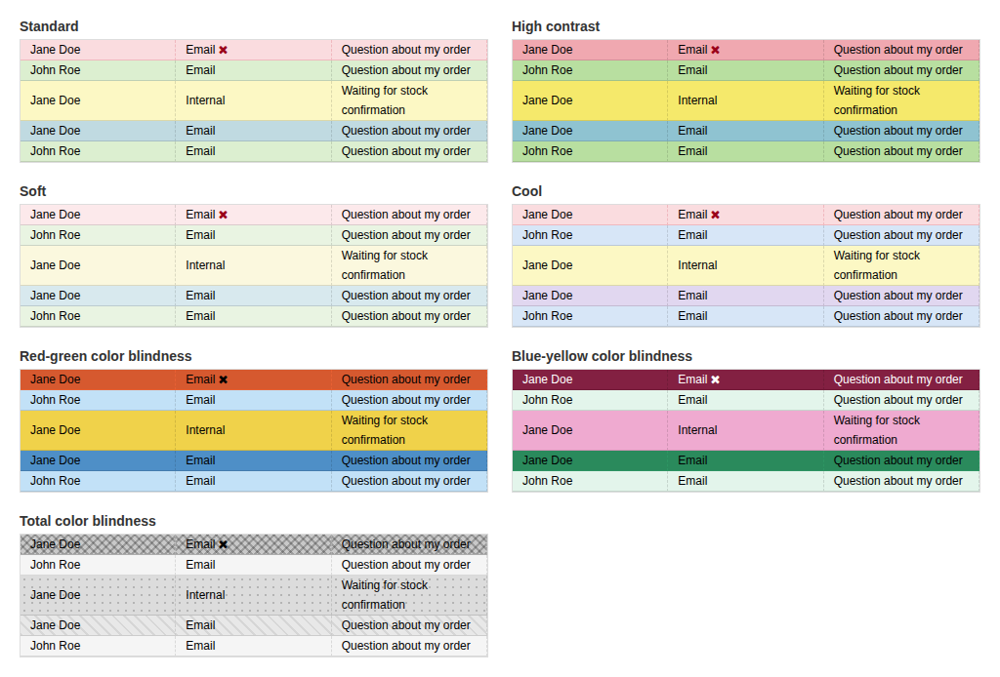
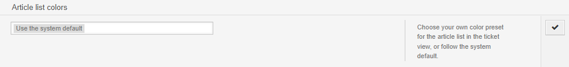
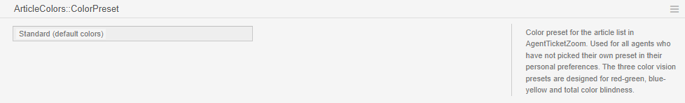

# ArticleColors

Color-coded article list for the ticket view (`AgentTicketZoom`) in Znuny LTS 6.5.

[](https://www.gnu.org/licenses/gpl-3.0)
[](https://www.znuny.org/)

> **Maintenance status:** This package is published as-is, in case it is useful to others. It is not actively maintained. Pull requests are not accepted. Questions and ideas are welcome in [Discussions](../../discussions); bug reports in Issues may go unanswered for a long time. You are welcome to fork it and make it your own (GPLv3).

Znuny colors the article list by customer visibility only. ArticleColors colors each row by who sent the article and over which channel, so a long ticket can be scanned at a glance: where the customer wrote, where we answered, which notes are internal, and which replies never left the system.



## What it colors

| Row | Rule | Standard preset |
|---|---|---|
| Customer email | sender is the customer, channel Email | light green |
| Our email to the customer | sender is an agent, visible to the customer, channel Email | light teal |
| Internal note | channel Internal, regardless of the "visible for customer" flag | light yellow |
| Failed delivery | the row shows Znuny's "sending of this message has failed" icon | light red |

A failed delivery wins over the other categories. Phone and chat articles belong to no category and keep Znuny's own colors.

## Presets

The system default is the SysConfig setting `ArticleColors::ColorPreset`. Each agent can override it under **Personal preferences → Miscellaneous → Article list colors**, or follow the system default.





| Preset | Purpose |
|---|---|
| `Standard` | Green, teal, yellow and red. |
| `HighContrast` | The same hues, more saturated. |
| `Soft` | The same hues, less saturated. |
| `Cool` | Blue and purple instead of green and teal. |
| `RedGreenCVD` | Red-green color blindness (protanopia and deuteranopia). |
| `BlueYellowCVD` | Blue-yellow color blindness (tritanopia). |
| `Achromatopsia` | Total color blindness: patterns instead of colors. |

The three color vision presets were checked with pairwise color differences (Delta E in OKLab) between the four category colors, for normal vision and for the deficiency in question:

| Preset | Deuteranopia | Tritanopia | Normal vision |
|---|---|---|---|
| `RedGreenCVD` | 19.2 | 12.6 | 19.3 |
| `BlueYellowCVD` | 14.0 | 18.0 | 18.2 |

`RedGreenCVD` serves both protanopia and deuteranopia: the blue and yellow axis it uses does not depend on telling red from green. `Achromatopsia` cannot reach a useful Delta E with four grays that still work as row backgrounds, so it uses stripes, dots and a crosshatch as the primary cue and a light gray ladder as the secondary one.

Text contrast on every category and preset, in normal and hover/selected state, is 4.7:1 or better (WCAG), measured in Chromium on the rendered table. The dark rows of the color vision presets use black or white text accordingly. The failed-delivery icon is recolored in the same way, because Znuny's own red has under 3:1 contrast on almost every preset: dark red on the light presets, black or white on the others.

## Requirements

- Znuny LTS 6.5.x. Developed and tested on 6.5.26. It has not been tested on Znuny 7.x.
- A browser with CSS `:has()` and `:where()` (Chrome, Edge, Firefox or Safari from 2023 or later). In an older browser a failed delivery simply keeps its normal category color.

## Installation

Download `ArticleColors-1.0.0.opm` from the Releases page. Install it from the command line and restart the web server so mod_perl picks up the new filter and configuration:

```shell
sudo -u otrs /opt/otrs/bin/otrs.Console.pl Admin::Package::Install /path/to/ArticleColors-1.0.0.opm
sudo systemctl restart apache2
```

Installing through **Admin → Package Manager** works as well. Upgrade with `Admin::Package::Upgrade` and remove with `Admin::Package::Uninstall ArticleColors`. Uninstalling removes all files and settings; only the agents' stored preference values stay behind in `user_preferences` (key `UserArticleColorsPreset`), which is harmless.

To build the package yourself, point `--module-directory` at `src/` so the package contains the files in the repository and not whatever is already installed:

```shell
sudo -u otrs /opt/otrs/bin/otrs.Console.pl Dev::Package::Build \
    --module-directory /path/to/repo/src \
    /path/to/repo/src/ArticleColors.sopm /output/dir/
```

## Configuration

| Setting | Description | Default |
|---|---|---|
| `ArticleColors::ColorPreset` | Preset used for agents who have not picked their own. | `Standard` |
| `PreferencesGroups###ArticleColorsPreset` | The personal preference. The keys of its `Data` hash are also the presets the output filter accepts. | active |

The English preset names in the table above are the keys stored in the settings.

## How it works

Three parts. No core file is changed or overridden.

- `src/Kernel/Output/HTML/OutputFilter/ArticleColors.pm` is a `Frontend::Output::FilterElementPost` filter on the template `AgentTicketZoom`. It adds `Preset-<name>` to the `UseArticleColors` containers that core already renders, and `Channel-<name>` to every article row. The channel comes from one `ArticleList()` call per ticket. Ticket and article IDs are read from each row's own `ArticleInfo` hidden input. The filter is idempotent, because Znuny can filter the same markup twice when a template is rendered in parts.
- `src/var/httpd/htdocs/skins/Agent/default/css/ArticleColors.css` defines the colors as CSS custom properties (`--ac-cN-bg`, `-hover`, `-fg`, `-pattern`). Each `Preset-<name>` class redefines them and one shared rule paints the cells. It lives in the default skin because the Loader always loads that skin first.
- `src/Kernel/Config/Files/XML/ArticleColors.xml` registers the stylesheet, the system preset, the personal preference (`Kernel::Output::HTML::Preferences::Generic`, stored as `UserArticleColorsPreset`) and the filter.

A preset exists in three places that must be kept in sync when one is added: the options of `ArticleColors::ColorPreset`, the `Data` hash of `PreferencesGroups###ArticleColorsPreset`, and a `Preset-<name>` block in the CSS.

The package deliberately does not override `AgentTicketZoom.tt`. An override means shipping a copy of a 3000-line core template that has to be re-diffed at every Znuny update, and it conflicts with any other package that overrides the same template. If the filter's row pattern stops matching after a core change, rows simply keep Znuny's colors.

### CSS notes

- Core's own rules (`tr.NotVisibleForCustomer`, `tr.system`) paint the same cells, so the background rules use `!important`.
- Core sets links in the article table to `#000` through an id selector, so the link rule repeats `#ArticleTable` to beat it.
- Znuny's CSS minifier removes the space before a colon: `.UseArticleColors :is(...)` becomes `.UseArticleColors:is(...)` and matches nothing. Every `:is()` and `:where()` therefore follows a type selector.
- The three category rules use `:where()` so the failed-delivery rule wins by specificity. With plain class chains the category 2 rule (five classes) outranks it, and a failed reply would be colored as a normal reply.
- Core colors the failed-delivery icon with `.Error { color: #ff505e }`. A plainer selector in the stylesheet replaces it with a color chosen per preset.

## Tests

```shell
sudo -u otrs /opt/otrs/bin/otrs.Console.pl Dev::UnitTest::Run --test ArticleColors
```

The tests cover preset selection (system default, personal choice, "follow default", stale and hostile stored values), the channel classes, idempotency and unknown articles.

## Translations

The source strings are English. A Swedish translation is included in `src/Kernel/Language/sv_ArticleColors.pm`.

## AI assistance

ArticleColors was written with Claude Code (Anthropic) as a pair-programming assistant: the design, the CSS and the Perl code, the unit tests and this documentation were drafted together with it.

The maintainer reviewed every change and is responsible for the result. The package is tested on Znuny 6.5.26 (unit tests, ZnunyCodePolicy, and checks in a test environment with all seven presets). It has not been tested on Znuny 7.x.

## License

GNU General Public License, version 3. See [COPYING](COPYING).
